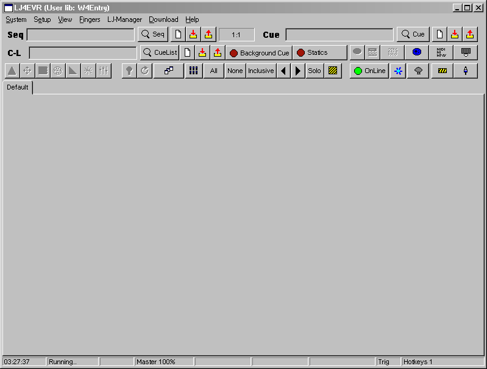

# LJ4EVR

A C11 clone of Martin LightJockey 2 (2.209 feature set, 2.100 help as the
behavioural reference) for Windows and macOS, with sACN E1.31 output. One static
executable per OS; SDL3 supplies the window, input, timers and a surface blit,
every pixel is drawn by LJ4EVR itself, so both OSes produce identical images.

LightJockey is a trademark of Martin Professional; LJ4EVR is not affiliated with or endorsed by Martin Professional or HARMAN.
Art-Net is a trade mark of Artistic Licence: Art-Net(TM) Designed by and Copyright Artistic Licence.

Status: **1.2.0** lands the rows the 1.1.0 review carried forward, among them
the Global Patch Use / Ignore DMX In Enable switch. 1.1.0 added the seven
features 1.0.0 left out: Art-Net output, the
Audio Analyzer and audio trig, the `.LJB` importer, DMX-in over sACN and
Art-Net, the RS-232 / TCP remote, External Application string output and the
LJ MediaPlayer. 1.0.0 was the first full release: every LightJockey 2 window of
the feature inventory, cue lists, macros, follow spots, `.GS2` / `.Udf` profiles
and sACN output.
What each version leaves out is below (`CHANGELOG.md`).

**Using it:** download the installer from the Releases page and read
[`docs/user-guide.md`](docs/user-guide.md); the same help is inside the program
under Help.

## Build

Windows (MSVC 2022, CMake >= 3.25):

    cmake --preset dev-msvc
    cmake --build --preset dev-msvc
    ctest --preset dev-msvc

macOS (Xcode command-line tools, Ninja, CMake >= 3.25):

    cmake --preset dev-mac
    cmake --build --preset dev-mac
    ctest --preset dev-mac

Without SDL (what the Linux CI container builds; tests and the headless renderer only):

    cmake -S . -B build-nosdl -DLJ_SDL=OFF
    cmake --build build-nosdl
    ctest --test-dir build-nosdl

Presets: `dev-msvc`, `dev-ninja-msvc`, `debug-win` (asserts on), `dev-mac`, `ci-linux-asan`,
`ci-linux-clang`, `release-win`, `release-mac` (`CMakePresets.json`). Build directories are `build-*/`
under the repo and are ignored by git.

## What v1.0.0 is not

Design section 1, verbatim:

v1.0.0 tags at the end of W4 and ships without the Audio Analyzer and audio trig
(inventory §5 "Keep, built in"), DMX-in over sACN input and the `.vtr` tables
(inventory §5 "Keep over sACN/Art-Net input"), the RS-232/TCP remote protocol,
External Application string output, the `.LJB` importer, the LJ MediaPlayer
(inventory §5 "Keep (cross-platform player)"; section 8.5 states what its
cue-list rows and transport buttons do until then) and Art-Net `[D14]`. All
seven are W5 (section 10). Every menu item, cue-list command and toolbar button
that belongs to one of them is still present, greyed, with the hint
`Not available in LJ4EVR`, so the chrome matches and the gap is visible. Joey
may pull any of them forward before W3; the default is the list above.

## What v1.1.0 is not

v1.1.0 (W5) delivers all seven items of the v1.0.0 list above: Art-Net output beside sACN, the Audio Analyzer and
audio trig, the `.LJB` importer, DMX-in over sACN and Art-Net input with the `.vtr` tables, the RS-232 / TCP remote
protocol, External Application string output and the LJ MediaPlayer. It still leaves out:

- the reference rig (design D4): every timing and layering rule tagged `PROPOSAL rig` stays a best estimate until it
  is compared with LightJockey 2 on real fixtures;
- audio CD and Winamp (DA) playback, dropped for good: their cue-list rows, time-code buttons and Hardware Setup rows
  stay greyed with the hint `Not available in LJ4EVR`;
- video: SDL3 decodes WAV and nothing else, and no codec library is added, so the MediaPlayer plays WAV sound files
  only and its video options stay greyed;
- the Global Patch per-channel "Use / Ignore DMX In Enable" items, which need a per-channel flag in the patch record
  and an engine rule.

## What v1.2.0 is not

v1.2.0 (W6) lands the rows the v1.1.0 review carried forward and makes the Global Patch per-channel "Use / Ignore DMX
In Enable" items live. It still leaves out:

- the reference rig (design D4): every timing and layering rule tagged `PROPOSAL rig` stays a best estimate until it
  is compared with LightJockey 2 on real fixtures;
- audio CD and Winamp (DA) playback, dropped for good: their cue-list rows, time-code buttons and Hardware Setup rows
  stay greyed with the hint `Not available in LJ4EVR`;
- video: SDL3 decodes WAV and nothing else, and no codec library is added, so the MediaPlayer plays WAV sound files
  only and its video options stay greyed;
- multi-select in the Global Patch list: Use / Ignore, Set DMX In / Out Sequence and `<- Set Values` act on the one
  selected row.

## Docs

Citations such as `design 7.4`, `note 13`, `[06 s4.2]` or `inventory §5` refer to the maintainer's design and
research notes, which are not published; the facts they support are in the code and in `docs/`.

For users:

- [`docs/user-guide.md`](docs/user-guide.md) - install, the data folder, the first show, what this version leaves out
- [`docs/fidelity.md`](docs/fidelity.md) - every known deviation from LightJockey 2.209 and the decision behind it
- `help/*.txt` - the help topics the program shows (Help menu), our own text

For contributors:

- [`CONTRIBUTING.md`](CONTRIBUTING.md) - fidelity rules, no Martin assets, code rules, goldens
- [`SECURITY.md`](SECURITY.md) - reporting a vulnerability, what is in scope
- [`docs/provenance.md`](docs/provenance.md) - where every non-code byte in the repository came from
- [`docs/building.md`](docs/building.md) - configure, build and test on Windows, macOS and Linux
- [`docs/releasing.md`](docs/releasing.md) - tagging, `release.yml`, the installers and their checks
- [`docs/ci.md`](docs/ci.md) - the three workflows, the runner security model, the CI image
- [`docs/conventions.md`](docs/conventions.md) - the coding conventions every file under `src/` follows
- [`docs/file-formats.md`](docs/file-formats.md) - the user library on disk (text records, INI files, `.lj4b`, `.bez`, the folders)
- [`docs/fixtures.md`](docs/fixtures.md) - the fixture library: exe rows, hand profiles, QLC+ tier 2, `qxf_map.tsv`
- [`docs/fonts.md`](docs/fonts.md) - the clean-room bitmap faces and the width corpus
- [`docs/generated-files.md`](docs/generated-files.md) - every committed generated file, its tool and its check
- [`docs/hotkeys.md`](docs/hotkeys.md) - the hotkey function table and the `.Hot` setups
- [`docs/midi.md`](docs/midi.md) - MIDI-IN: the backends, the map, Learn and the UI-thread dispatch
- [`docs/msvc-sdl-build.md`](docs/msvc-sdl-build.md) - why the CMake file carries two MSVC workarounds
- [`docs/replay-grammar.md`](docs/replay-grammar.md) - the `.lj4r` engine replay scenarios
- [`docs/running.md`](docs/running.md) - running the app, `Main.Ini`, `--selftest` and the other flags
- [`docs/sacn.md`](docs/sacn.md) - the sACN sender, `Hardware.Ini [SACN]`, the LAN capture
- [`docs/artnet.md`](docs/artnet.md) - Art-Net output per link, discovery, the socket, `Hardware.Ini [ARTNET]`
- [`docs/dmx-in.md`](docs/dmx-in.md) - DMX-in over sACN and Art-Net, the merge rule, the `.vtr` value tables, the functions
- [`docs/audio.md`](docs/audio.md) - the Audio Analyzer, audio trig, permissions and the analyzer's numbers
- [`docs/remote.md`](docs/remote.md) - the RS-232 / TCP 3-byte remote protocol (off by default, no authentication)
- [`docs/extapp.md`](docs/extapp.md) - External Application string output: the grammar and the transports
- [`docs/media.md`](docs/media.md) - the LJ MediaPlayer (WAV only) and the nine MP cue-list commands
- [`docs/ljb-import.md`](docs/ljb-import.md) - importing a LightJockey 2 `.LJB` backup into a new library
- [`docs/ui-script.md`](docs/ui-script.md) - the `--script` driver behind the acceptance walkthroughs
- `docs/screenshots/` - the wave acceptance captures (our own windows)
- `docs/w0-*.md` .. `docs/w5-*.md` - per-wave contracts, gate tables and integration logs (the build record)

## Licence

MIT (`LICENSE`). Third-party notices: `NOTICE`, shipped in both
installers as `THIRD_PARTY_NOTICES.txt` with the full SDL3 (zlib), miniz (MIT) and
QLC+ (Apache-2.0) texts. Fonts and art are CC0 (`docs/provenance.md`).
